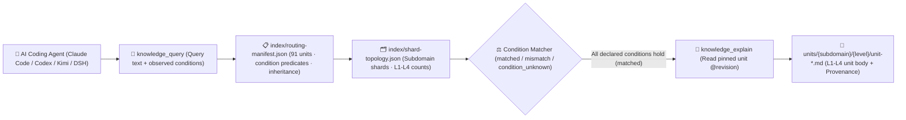

<p align="center">
  
</p>

<h1 align="center">MindIE Agent Knowledge — vLLM-Ascend Domain Corpus (<code>knowledge-vllm-ascend</code>)</h1>

<p align="center">
  <strong>Graded L1–L4 engineering knowledge corpus for Ascend NPUs and vLLM-Ascend: covering 0-day model bring-up, TorchAir/ACLGraph capture, MoE/EP parallelism, PD disaggregation, and precision/performance triage</strong>
</p>

<p align="center">
  <a href="https://github.com/mindie-agent/mindie-agent"></a>
  <a href="./publication-contract.json"></a>
  <a href="./publication-contract.json"></a>
  <a href="./index/routing-manifest.json"></a>
  <a href="./index/shard-topology.json"></a>
</p>

<p align="center">
  <a href="./README.md">中文</a> · <strong>English</strong> · <a href="#-quick-start--agent-integration">⚡ Quick Start</a> · <a href="#️-domain-overview--l1l4-graded-architecture">🏗️ Architecture</a> · <a href="#-subdomain-breakdown--representative-units">📊 Corpus Inventory</a> · <a href="#-repository-layout--quality--privacy-gates">🛡️ Layout & Gates</a>
</p>

---

## ⚡ Quick Start & Agent Integration

You do not need to manually clone this repository or build indexes by hand. Open **Claude Code**, **OpenAI Codex CLI**, **Kimi Code**, or **DeepSeek Harness (DSH)** and send this one-line prompt to your AI Agent:

```text
Please install https://github.com/mindie-agent/mindie-agent for me
```

Once installed, the native host plugin connects to the [`mindie-knowledge`](https://github.com/mindie-agent/knowledge) local runtime, syncs this domain corpus (`--domain vllm-ascend`), and builds a local deterministic index. Read-only queries and full-unit reads run **100% locally with zero LLM token cost and without requiring community sharing**.

<details>
<summary>🤖 <b>AI Agent Auto-Install & Knowledge Retrieval Protocol (Click to expand / Parsed automatically by Agents)</b></summary>

> **Instructions for AI Agents**:
>
> #### 1. Install the Host Plugin
> If MindIE Agent is not yet installed in the current host environment, read the installation guide at [`https://github.com/mindie-agent/mindie-agent`](https://github.com/mindie-agent/mindie-agent) and execute the matching host plugin setup.
>
> #### 2. Sync & Inspect the `vllm-ascend` Corpus via CLI
> ```bash
> # Sync the latest verified public corpus for vllm-ascend (zero LLM calls)
> mindie-knowledge sync --domain vllm-ascend
>
> # Inspect local index status and active redaction profile
> mindie-knowledge status --domain vllm-ascend
> python3 -m mindie_knowledge.redact --profile
> ```
>
> #### 3. Query, Explain & Record Feedback via MCP Tools
> When solving engineering tasks in `vllm-ascend`, follow the standard workflow: **Query with observed facts (`knowledge_query`) → Read full body by pinned revision (`knowledge_explain`) → Optionally record feedback after verification (`knowledge_feedback`)**:
>
> ```python
> # Step 1: Pass only facts actually observed in the current task (never guess or copy unverified conditions)
> knowledge_query(
>     query="custom op import registration NZ selection",
>     conditions={
>         "repository": "vllm-project/vllm-ascend",
>         "revision": "175ef4d49c2072f9233619636f0309f4f88b4e2c"
>     },
> )
>
> # Step 2: Read the full Markdown body, frontmatter, and inheritance closure using the pinned @revision ref
> knowledge_explain(
>     ref="mindie://vllm-ascend/units/unit-vllm-ascend-custom-op-gates-import-retry-and-nz@3",
> )
>
> # Step 3: Optionally record usefulness feedback against the exact observed revision after real verification
> knowledge_feedback(
>     ref="mindie://vllm-ascend/units/unit-vllm-ascend-custom-op-gates-import-retry-and-nz@3",
>     rating="up",
>     reason="Verified custom op import gate and NZ format dispatch condition on vllm-ascend.",
> )
> ```

</details>

---

## 🏗️ Domain Overview & L1–L4 Graded Architecture

This repository hosts the **`vllm-ascend` graded domain knowledge corpus** for MindIE Agent (**91 graded units**: `L1: 10`, `L2: 55`, `L3: 23`, `L4: 3`). It covers 0-day model bring-up on Ascend Atlas A2 / A3 NPUs (DeepSeek-V4/V4.1, Qwen3.5 GatedDeltaNet, Kimi K3, multimodal VLM/DiT/VLA), TorchAir / ACLGraph capture and replay, MoE Expert Parallelism (AllToAll / MC2 / SHMEM / EPLB), Prefill-Decode (PD) disaggregation with HIXL/Mooncake KV transfer, W8A8/W4A8/C8 quantization, speculative decoding (MTP/DSpark), and runtime fault/precision triage.

### 1. The `mindie-graded-unit/1` L1–L4 Hierarchy

Instead of lossy chat summaries or unconditioned "best practices", every knowledge unit in this repository is structured into **four graded levels (L1–L4)** based on engineering abstraction and actionability (current breakdown: **L1: 10 · L2: 55 · L3: 23 · L4: 3**):

| Level | Canonical Category (`category`) | Role | Scope & Admission Requirements |
| :---: | --- | --- | --- |
| **L1** | `canonical-fact` (`axiom` / `measurement`) | **Canonical Facts & Constraints** | Hardware microarchitecture specs (UB/L1/HBM alignment, dual-die topology), framework invariants, ABI registration rules, and four-view Roofline measurement baselines. Inherited by higher-tier units via `parents`. |
| **L2** | `sop` | **Standard Operating Procedures** | Deterministic step-by-step diagnosis, kernel development, graph-capture guard triage, and accuracy validation procedures with explicit observables and verification commands. |
| **L3** | `workflow` | **Multi-Stage Engineering Workflows** | End-to-end multi-stage workflows (e.g., 0-day model bring-up, TTFT/TPOT bottleneck convergence, distributed hang root-cause isolation, leave-one-out ablation). |
| **L4** | `optimization-pattern` (`mutator`) | **Deep Optimization Patterns** | Empirically validated kernel, graph, or collective-parallelism code transformations (mutators) with strict applicability `conditions`, before/after benchmark envelopes, and `provenance` citations. |

### 2. Condition-Matched Routing & Retrieval Pipeline



> [!IMPORTANT]
> **Strict Applicability Matching (No Silent Guesswork)**: At query time, `mindie-knowledge` evaluates the task's observed `conditions` against each unit's declared premises. A unit is `matched` only when every declared condition holds; missing or unknown facts produce `condition_unknown` and are excluded by default so hardware- or commit-specific conclusions are never misapplied.

---

## 📊 Subdomain Breakdown & Representative Units

[`index/routing-manifest.json`](./index/routing-manifest.json) and [`index/shard-topology.json`](./index/shard-topology.json) are the authoritative derived inventories rebuilt from the Markdown units. This repository currently contains **91 graded knowledge units** (**L1: 10 · L2: 55 · L3: 23 · L4: 3**):

### 1. Subdomain Statistics

| Subdomain | Units | Level Breakdown (`L1–L4`) | Core Engineering Scope |
| --- | :---: | :---: | --- |
| `vllm-ascend` | **84** | `L1: 5, L2: 54, L3: 23, L4: 2` | Core runtime, ACLGraph capture, 0-day model bring-up (DeepSeek-V4/Qwen3.5/Kimi K3/VLM), MoE EP/MC2, PD disaggregation, MTP speculative decoding, and `vllm-omni` multi-stage omni-modality (`Thinker -> Talker -> Code2Wav` / AR+DiT / TTS / Duplex) pipelines |
| `_common` | **5** | `L1: 5` | Inherited foundational invariants: Ascend NPU graph-capture & custom-kernel binding premises, idle-DP HCCL collective invariants, and eager/graph state parity gates |
| `integration` | **1** | `L2: 1` | Custom-op import retry, registration, and Fractal NZ format selection gate SOP |
| `0day` | **1** | `L4: 1` | Qwen3.5 GDN idle-DP zero-padded workspace and empty-batch HCCL participation optimization mutator |

### 2. Representative Graded Knowledge Units

| Unit ID (Click to view Markdown) | Subdomain | Tier / Category | Summary | Pinned Reference (`ref`) |
| --- | :---: | :---: | --- | --- |
| [`unit-vllm-ascend-npu-runtime-and-graph-invariants`](./_common/unit-vllm-ascend-npu-runtime-and-graph-invariants.md) | `_common` | **L1** / `axiom` | Ascend NPU graph-capture and custom-kernel binding premises | `mindie://vllm-ascend/units/unit-vllm-ascend-npu-runtime-and-graph-invariants@2` |
| [`unit-vllm-ascend-hccl-and-dp-collective-invariants`](./_common/unit-vllm-ascend-hccl-and-dp-collective-invariants.md) | `_common` | **L1** / `axiom` | HCCL and DP collective invariants for idle ranks | `mindie://vllm-ascend/units/unit-vllm-ascend-hccl-and-dp-collective-invariants@1` |
| [`unit-vllm-ascend-dsv4-v41-qli-v2-compressor-and-engram-axioms`](./vllm-ascend/models/deepseek-v4-v41/unit-vllm-ascend-dsv4-v41-qli-v2-compressor-and-engram-axioms.md) | `vllm-ascend` | **L1** / `axiom` | DeepSeek-V4/V4.1 MLA latent, LightningIndexer/QLI-v2, Compressor/Engram, and absorption invariants | `mindie://vllm-ascend/units/unit-vllm-ascend-dsv4-v41-qli-v2-compressor-and-engram-axioms@1` |
| [`unit-vllm-ascend-custom-op-gates-import-retry-and-nz`](./integration/custom-ops/unit-vllm-ascend-custom-op-gates-import-retry-and-nz.md) | `integration` | **L2** / `sop` | Ascend custom-op imports, registration and NZ selection have distinct gates | `mindie://vllm-ascend/units/unit-vllm-ascend-custom-op-gates-import-retry-and-nz@3` |
| [`unit-vllm-ascend-aclgraph-capture-invalidation-triage-sop`](./vllm-ascend/runtime/graph-capture/unit-vllm-ascend-aclgraph-capture-invalidation-triage-sop.md) | `vllm-ascend` | **L2** / `sop` | ACLGraph capture invalidation, dynamic shape bucketing, and stream sync triage SOP | `mindie://vllm-ascend/units/unit-vllm-ascend-aclgraph-capture-invalidation-triage-sop@1` |
| [`unit-vllm-ascend-pd-hixl-mooncake-layerwise-kv-push-and-release-sop`](./vllm-ascend/optimizations/kv-cache-and-pd-disaggregation/pd-transfer-sync/unit-vllm-ascend-pd-hixl-mooncake-layerwise-kv-push-and-release-sop.md) | `vllm-ascend` | **L2** / `sop` | Prefill-Decode (PD) disaggregation KV transfer: 2 MiB HIXL alignment, layerwise Event push, ACK-gated block release, and RDMA timeout budgeting | `mindie://vllm-ascend/units/unit-vllm-ascend-pd-hixl-mooncake-layerwise-kv-push-and-release-sop@1` |
| [`unit-vllm-ascend-moe-ep-stage-dispatch-mc2-and-double-routing-sop`](./vllm-ascend/optimizations/moe-and-ep/dispatch-combine-routing/unit-vllm-ascend-moe-ep-stage-dispatch-mc2-and-double-routing-sop.md) | `vllm-ascend` | **L2** / `sop` | Stage-aware MoE Expert Parallelism dispatch selection: double-routing AllToAll, MC2 fused dispatch-combine, SHMEM, and 256-expert AllGather-EP | `mindie://vllm-ascend/units/unit-vllm-ascend-moe-ep-stage-dispatch-mc2-and-double-routing-sop@1` |
| [`unit-vllm-ascend-0day-hybrid-model-bringup-hermes-workflow`](./vllm-ascend/runtime/qwen35-gated-deltanet-decode/unit-vllm-ascend-0day-hybrid-model-bringup-hermes-workflow.md) | `vllm-ascend` | **L3** / `workflow` | 0-day Qwen3.5 GatedDeltaNet + Attention bring-up workflow on vllm-ascend | `mindie://vllm-ascend/units/unit-vllm-ascend-0day-hybrid-model-bringup-hermes-workflow@2` |
| [`unit-vllm-ascend-prefill-decode-bottleneck-convergence-workflow`](./vllm-ascend/performance/prefill-decode/unit-vllm-ascend-prefill-decode-bottleneck-convergence-workflow.md) | `vllm-ascend` | **L3** / `workflow` | Hermes workflow: vllm-ascend TTFT vs TPOT/ITL bottleneck attribution and convergence | `mindie://vllm-ascend/units/unit-vllm-ascend-prefill-decode-bottleneck-convergence-workflow@2` |
| [`unit-vllm-ascend-moe-shared-expert-dual-stream-and-eplb-workflow`](./vllm-ascend/optimizations/moe-and-ep/eplb-and-multistream/unit-vllm-ascend-moe-shared-expert-dual-stream-and-eplb-workflow.md) | `vllm-ascend` | **L3** / `workflow` | MoE shared-expert dual-stream overlap, core-limit deadlock prevention, EPLB scale-tensor remapping, and AFD disaggregation workflow | `mindie://vllm-ascend/units/unit-vllm-ascend-moe-shared-expert-dual-stream-and-eplb-workflow@1` |
| [`unit-vllm-ascend-dspark-mtp-aclgraph-d2h-elimination-mutator`](./vllm-ascend/speculative-decoding/unit-vllm-ascend-dspark-mtp-aclgraph-d2h-elimination-mutator.md) | `vllm-ascend` | **L4** / `mutator` | v2 DSpark ACLGraph bucket alignment and device-resident D2H elimination | `mindie://vllm-ascend/units/unit-vllm-ascend-dspark-mtp-aclgraph-d2h-elimination-mutator@2` |
| [`unit-vllm-ascend-dsv4-v41-query-dequant-and-lighting-indexer-fusion-mutator`](./vllm-ascend/models/deepseek-v4-v41/unit-vllm-ascend-dsv4-v41-query-dequant-and-lighting-indexer-fusion-mutator.md) | `vllm-ascend` | **L4** / `mutator` | Fuse DeepSeek-V4/V4.1 query dequant and RoPE split, alias LightningIndexer views, and keep top-k block masks device-resident | `mindie://vllm-ascend/units/unit-vllm-ascend-dsv4-v41-query-dequant-and-lighting-indexer-fusion-mutator@1` |
| [`unit-vllm-omni-multistage-pipeline-deploy-and-npu-platform-axioms`](./vllm-ascend/vllm-omni/architecture/unit-vllm-omni-multistage-pipeline-deploy-and-npu-platform-axioms.md) | `vllm-ascend` | **L1** / `axiom` | vllm-omni multi-stage OmniStage DAG, OmniConnector transport, and NPUPlatform axioms | `mindie://vllm-ascend/units/unit-vllm-omni-multistage-pipeline-deploy-and-npu-platform-axioms@1` |
| [`unit-vllm-omni-multistage-ttfp-rtf-and-pipeline-convergence-workflow`](./vllm-ascend/vllm-omni/workflows/unit-vllm-omni-multistage-ttfp-rtf-and-pipeline-convergence-workflow.md) | `vllm-ascend` | **L3** / `workflow` | vllm-omni multi-stage TTFP vs RTF attribution, async_chunk tuning, and Talker decode convergence workflow | `mindie://vllm-ascend/units/unit-vllm-omni-multistage-ttfp-rtf-and-pipeline-convergence-workflow@1` |

---

## 🛡️ Repository Layout & Quality / Privacy Gates

### 1. Directory Structure

```text
knowledge-vllm-ascend/
├── publication-contract.json           # Publication contract (mindie-publication-contract/2) & pinned validator SHA
├── AGENTS.md                           # Maintainer and AI-Agent repository boundary rules
├── README.md                           # Primary documentation (Chinese)
├── README.en.md                        # Primary documentation (English)
├── LICENSE                             # Dual license (CC BY 4.0 corpus & docs + MIT scripts)
├── index/
│   ├── routing-manifest.json           # [Derived Index] Live unit IDs, paths, tiers, conditions, inheritance & token estimates
│   └── shard-topology.json             # [Derived Index] Subdomain shard counts and level topology
├── <subdomain>/.../unit-*.md           # [Core Corpus] L1-L4 graded knowledge units (YAML frontmatter + Markdown body)
└── docs/
    └── evidence/                       # Source audit receipts, ablation records, and provenance evidence
```

### 2. Two-Layer Privacy Redaction & Deterministic CI Gate (`.github/workflows/check.yml`)

Every push and pull request targeting `main` is enforced by `.github/workflows/check.yml` with zero-trust validation and two-layer privacy redaction:

1. **Immutable Contract & Pure-Blob Validation (`publication_check.validate`)**:
   - CI reads [`publication-contract.json`](./publication-contract.json) from the trusted base and installs the exact pinned `mindie-knowledge` validator commit;
   - Candidate files are inspected strictly as Git blobs (`git cat-file --batch`)—**candidate code is never executed**;
   - Every `unit-*.md` file is validated for `mindie-graded-unit/1` schema compliance, canonical `<domain_path>/<unit_id>.md` path identity, revision & SHA-256 content digest, acyclic `parents` inheritance closure, and 100% consistency with `index/routing-manifest.json` and `index/shard-topology.json`.
2. **Two-Layer Closed-Loop Privacy Redaction (Gitleaks + `mindie_knowledge.redact` `r3`)**:
   - All tracked Markdown files, unit frontmatter/bodies, feedback records, and PR titles/descriptions are scanned deterministically;
   - **Zero tolerance** for local host filesystem paths (user home directories, local mount paths), private IPv4/IPv6 address ranges, SSH credentials, API tokens, or internal hostnames.

---

## 🗃️ Historical Material Archive (`material-v1`)

The legacy `material-v1` task corpus is archived under `docs/archive/material-v1/85ab134f333b06ac3873df6affbf3bf6ec71978c/` and at immutable historical commit [`85ab134f333b06ac3873df6affbf3bf6ec71978c`](https://github.com/mindie-agent/knowledge-vllm-ascend/tree/85ab134f333b06ac3873df6affbf3bf6ec71978c).
- The archive is retained strictly as historical provenance evidence and **does not participate** in active `mindie-graded-unit/1` retrieval;
- [`index/routing-manifest.json`](./index/routing-manifest.json) is the sole authoritative inventory of active graded units;
- See [`docs/package-format.en.md`](./docs/package-format.en.md) and [`docs/CONTRIBUTING.en.md`](./docs/CONTRIBUTING.en.md) for full format and review specifications.

---

## 🔗 Related Repositories & Ecosystem

- **Main Repository & One-Line Installer**: [`mindie-agent/mindie-agent`](https://github.com/mindie-agent/mindie-agent)
- **Knowledge Runtime & Redaction Engine**: [`mindie-agent/knowledge`](https://github.com/mindie-agent/knowledge) (`mindie-knowledge`)
- **The 7 Public Domain Knowledge Corpora**:
  - [`knowledge-vllm-ascend`](https://github.com/mindie-agent/knowledge-vllm-ascend) — `vLLM-Ascend` & `vLLM-Omni` model bring-up, ACLGraph, MoE, PD disaggregation & omni pipelines (91 Units)
  - [`knowledge-operators`](https://github.com/mindie-agent/knowledge-operators) — AscendC / BiShengIR / Triton / TileLang / MindIE-SD operator development & optimization (105 Units)
  - [`knowledge-infer-core`](https://github.com/mindie-agent/knowledge-infer-core) — Core inference engine scheduling, KV cache, `MindIE-SD` DiT acceleration & serving (109 Units)
  - [`knowledge-infer-distributed`](https://github.com/mindie-agent/knowledge-infer-distributed) — HCCL collectives, RoCE/HCCS topology, Ulysses/Ring/CFG hybrid parallelism & SHMEM (39 Units)
  - [`knowledge-infer-observability`](https://github.com/mindie-agent/knowledge-infer-observability) — CANN fault diagnostics, `msprof` profiling & Window A/B/A perf/accuracy gates (39 Units)
  - [`knowledge-infer-ops-compat`](https://github.com/mindie-agent/knowledge-infer-ops-compat) — GE/TorchAir/Inductor graph compilation, custom-op registration & two-stage integration (34 Units)
  - [`knowledge-agent-engineering`](https://github.com/mindie-agent/knowledge-agent-engineering) — Multi-agent orchestration, S0–S6 auto-optimization, redaction audit & benchmarking (33 Units)

---

## 📄 License

This repository is dual-licensed under [`LICENSE`](./LICENSE) in alignment with the `mindie-publication-contract/2` repository layout:

- **Knowledge Corpus, Derived Indexes, Public Feedback & Documentation** (`<domain_path>/unit-*.md`, `index/`, `feedback/`, `README.md`, `README.en.md`, `AGENTS.md`, `docs/`) are licensed under **[Creative Commons Attribution 4.0 International (CC BY 4.0)](./LICENSE)**.
- **Repository Maintenance Scripts & Workflow Configuration** (`scripts/`, `.github/workflows/`, `publication-contract.json`) are licensed under the **[MIT License](./LICENSE)**.
