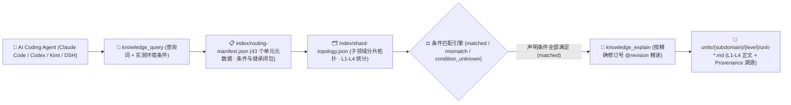

<p align="center">
  
</p>

<h1 align="center">MindIE Agent Knowledge — vLLM-Ascend 领域知识库 (<code>knowledge-vllm-ascend</code>)</h1>

<p align="center">
  <strong>面向昇腾 NPU 与 vLLM-Ascend 推理引擎的 L1–L4 分级工程知识库：覆盖 0-day 模型适配、TorchAir/ACLGraph 图编译、MoE/EP 并行、PD 分离与精度性能排障</strong>
</p>

<p align="center">
  <a href="https://github.com/mindie-agent/mindie-agent"></a>
  <a href="./publication-contract.json"></a>
  <a href="./publication-contract.json"></a>
  <a href="./index/routing-manifest.json"></a>
  <a href="./index/shard-topology.json"></a>
</p>

<p align="center">
  <strong>中文</strong> · <a href="./README.en.md">English</a> · <a href="#-一句话接入与检索">⚡ 一句话接入</a> · <a href="#️-领域全景与-l1l4-分级架构">🏗️ 分级架构</a> · <a href="#-子领域分布与代表性知识单元">📊 语料全景</a> · <a href="#-仓库结构与隐私质量门禁">🛡️ 结构与门禁</a>
</p>

---

## ⚡ 一句话接入与检索

你不需要手动克隆或配置索引。在 **Claude Code**、**OpenAI Codex CLI**、**Kimi Code** 或 **DeepSeek Harness (DSH)** 中，直接复制并发送下面这句话给你的 AI Agent：

```text
帮我安装一下这个 https://github.com/mindie-agent/mindie-agent
```

宿主插件就绪后会自动连接 [`mindie-knowledge`](https://github.com/mindie-agent/knowledge) 本地运行时，按需同步本仓库（`--domain vllm-ascend`）并在本地构建毫秒级确定性检索索引。只读检索与全文读取**完全在本地执行，不消耗大模型 Token，也不要求开启社区共享**。

<details>
<summary>🤖 <b>AI Agent 自动安装与知识检索协议（点击展开 / Agent 读取本页时可直接解析执行）</b></summary>

> **给 AI Agent 的执行指南**：
>
> #### 1. 一键安装宿主插件
> 若当前宿主尚未安装 MindIE Agent，请先读取主仓库 [`https://github.com/mindie-agent/mindie-agent`](https://github.com/mindie-agent/mindie-agent) 的安装协议完成对应宿主插件注册。
>
> #### 2. 命令行同步与检查 `vllm-ascend` 领域语料
> ```bash
> # 同步 vllm-ascend 领域最新经校验的公开知识源（零模型调用）
> mindie-knowledge sync --domain vllm-ascend
>
> # 查看本地知识索引状态与脱敏规则版本
> mindie-knowledge status --domain vllm-ascend
> python3 -m mindie_knowledge.redact --profile
> ```
>
> #### 3. MCP 工具检索、精确全文读取与版本化反馈
> 在解决 `vllm-ascend` 相关工程任务时，遵循 **先按实测条件检索 (`knowledge_query`) → 再按精确修订号读全文 (`knowledge_explain`) → 验证后可选反馈 (`knowledge_feedback`)** 的标准工作流：
>
> ```python
> # Step 1: 仅传入当前任务真实观测到的环境/版本条件（严禁猜测或抄写未观测条件）
> knowledge_query(
>     query="custom op import registration NZ selection",
>     conditions={
>         "repository": "vllm-project/vllm-ascend",
>         "revision": "175ef4d49c2072f9233619636f0309f4f88b4e2c"
>     },
> )
>
> # Step 2: 使用返回的精确修订引用 (@revision) 读取完整正文、前置条件与继承闭包
> knowledge_explain(
>     ref="mindie://vllm-ascend/units/unit-vllm-ascend-custom-op-gates-import-retry-and-nz@3",
> )
>
> # Step 3: 实机验证有效后，针对实际观测过的修订号记录本地有用性反馈（可选）
> knowledge_feedback(
>     ref="mindie://vllm-ascend/units/unit-vllm-ascend-custom-op-gates-import-retry-and-nz@3",
>     rating="up",
>     reason="Verified custom op import gate and NZ format dispatch condition on vllm-ascend.",
> )
> ```

</details>

---

## 🏗️ 领域全景与 L1–L4 分级架构

本仓库承载 MindIE Agent 的 **`vllm-ascend` 领域分级知识源**（共 **43 个分级知识单元**：`L1: 6`、`L2: 24`、`L3: 10`、`L4: 3`）。聚焦 `vLLM-Ascend` 在昇腾 Atlas A2 / A3 NPU 上的 0-day 新模型（如 DeepSeek-V4/V4.1、Qwen3.5 GatedDeltaNet、Kimi K3、多模态 VLM/DiT/VLA）适配、TorchAir / ACLGraph 图捕获与重放、MoE 专家并行（AllToAll / MC2 / SHMEM / EPLB）、Prefill-Decode（PD）分离与 HIXL/Mooncake KV 传输、W8A8/W4A8/C8 量化、投机解码（MTP/DSpark）以及运行时故障与精度对齐。

### 1. `mindie-graded-unit/1` 四级知识单元体系（L1–L4）

本知识库拒绝碎片化的聊天摘要或脱离前提的“万能经验”，所有知识单元均按工程抽象粒度与可操作性划分为 **L1–L4 四个层级**（当前分布：**L1: 6 · L2: 24 · L3: 10 · L4: 3**）：

| 层级 | 标准类别 (`category`) | 工程定位 | 核心内容与准入要求 |
| :---: | --- | --- | --- |
| **L1** | `canonical-fact` (`axiom` / `measurement`) | **事实与约束标准** | 硬件微架构规格（UB/L1/HBM 对齐、双 Die 拓扑）、框架核心不变量、ABI 注册规则与四视图 Roofline 测量基线。常作为上层单元的继承前提（`parents`）。 |
| **L2** | `sop` | **标准排障与开发规程** | 确定性的分步诊断、算子开发、图编译护栏排查与精度比对标准作业程序（SOP），明确列出观测指标、判别分支与验证命令。 |
| **L3** | `workflow` | **多阶段工程工作流** | 端到端多阶段闭环工作流（如 0-day 模型适配、TTFT/TPOT 性能瓶颈收敛、分布式死锁根因定位、留一法消融实验）。 |
| **L4** | `optimization-pattern` (`mutator`) | **深度调优模式** | 经过实测验证的 Kernel / 计算图 / 通信并行代码变换模式（Mutator），附带严格的适用条件（`conditions`）、消融前后性能包络与源码溯源（`provenance`）。 |

### 2. 条件化路由与精确全文检索架构



> [!IMPORTANT]
> **严格条件匹配原则（No Silent Guesswork）**：查询时，`mindie-knowledge` 会将任务真实观测到的 `conditions` 与知识单元声明的适用前提逐项比对。只有所有声明条件均满足时才判定为 `matched`；缺失或未知的条件判定为 `condition_unknown` 并默认过滤，避免将特定硬件型号或特定源码提交下的结论误用于不兼容环境。

---

## 📊 子领域分布与代表性知识单元

[`index/routing-manifest.json`](./index/routing-manifest.json) 与 [`index/shard-topology.json`](./index/shard-topology.json) 是由全量 Markdown 单元派生的权威实时清单。当前仓库共包含 **43 个分级知识单元**（**L1: 6 · L2: 24 · L3: 10 · L4: 3**）：

### 1. 子领域（Subdomain）分布统计

| 子领域目录 | 单元数量 | 层级分布 (`L1–L4`) | 核心覆盖范围 |
| --- | :---: | :---: | --- |
| `vllm-ascend` | **38** | `L1: 3, L2: 23, L3: 10, L4: 2` | 核心推理运行时、图模式捕获、0-day 模型适配（DeepSeek-V4/Qwen3.5/Kimi K3/VLM）、MoE EP/MC2、PD 分离、MTP 投机解码与量化排障 |
| `_common` | **3** | `L1: 3` | 跨单元继承的底层不变量：昇腾 NPU 图捕获与自定义算子绑定前提、空闲 DP Rank 的 HCCL 集合通信不变量、Eager/Graph 精度与循环状态门禁 |
| `integration` | **1** | `L2: 1` | 自定义算子（Custom Op）导入重试、算子注册与 NZ 格式选择门禁 SOP |
| `0day` | **1** | `L4: 1` | Qwen3.5 GDN 空闲 DP Rank 零填充 Workspace 与空 Batch HCCL 参与深度优化模式 |

### 2. 代表性分级知识单元（Representative Units）

| 知识单元 ID（点击查看原文） | 子领域 | 层级 / 类别 | 工程主题与摘要 | 固定修订引用 (`ref`) |
| --- | :---: | :---: | --- | --- |
| [`unit-vllm-ascend-npu-runtime-and-graph-invariants`](./_common/unit-vllm-ascend-npu-runtime-and-graph-invariants.md) | `_common` | **L1** / `axiom` | Ascend NPU graph-capture and custom-kernel binding premises | `mindie://vllm-ascend/units/unit-vllm-ascend-npu-runtime-and-graph-invariants@2` |
| [`unit-vllm-ascend-hccl-and-dp-collective-invariants`](./_common/unit-vllm-ascend-hccl-and-dp-collective-invariants.md) | `_common` | **L1** / `axiom` | HCCL and DP collective invariants for idle ranks | `mindie://vllm-ascend/units/unit-vllm-ascend-hccl-and-dp-collective-invariants@1` |
| [`unit-vllm-ascend-dsv4-v41-qli-v2-compressor-and-engram-axioms`](./vllm-ascend/models/deepseek-v4-v41/unit-vllm-ascend-dsv4-v41-qli-v2-compressor-and-engram-axioms.md) | `vllm-ascend` | **L1** / `axiom` | DeepSeek-V4/V4.1 MLA latent, LightningIndexer/QLI-v2, Compressor/Engram, and absorption invariants | `mindie://vllm-ascend/units/unit-vllm-ascend-dsv4-v41-qli-v2-compressor-and-engram-axioms@1` |
| [`unit-vllm-ascend-custom-op-gates-import-retry-and-nz`](./integration/custom-ops/unit-vllm-ascend-custom-op-gates-import-retry-and-nz.md) | `integration` | **L2** / `sop` | Ascend custom-op imports, registration and NZ selection have distinct gates | `mindie://vllm-ascend/units/unit-vllm-ascend-custom-op-gates-import-retry-and-nz@3` |
| [`unit-vllm-ascend-aclgraph-capture-invalidation-triage-sop`](./vllm-ascend/runtime/graph-capture/unit-vllm-ascend-aclgraph-capture-invalidation-triage-sop.md) | `vllm-ascend` | **L2** / `sop` | ACLGraph capture invalidation, dynamic shape bucketing, and stream sync triage SOP | `mindie://vllm-ascend/units/unit-vllm-ascend-aclgraph-capture-invalidation-triage-sop@1` |
| [`unit-vllm-ascend-pd-hixl-mooncake-layerwise-kv-push-and-release-sop`](./vllm-ascend/optimizations/kv-cache-and-pd-disaggregation/pd-transfer-sync/unit-vllm-ascend-pd-hixl-mooncake-layerwise-kv-push-and-release-sop.md) | `vllm-ascend` | **L2** / `sop` | Prefill-Decode (PD) disaggregation KV transfer: 2 MiB HIXL alignment, layerwise Event push, ACK-gated block release, and RDMA timeout budgeting | `mindie://vllm-ascend/units/unit-vllm-ascend-pd-hixl-mooncake-layerwise-kv-push-and-release-sop@1` |
| [`unit-vllm-ascend-moe-ep-stage-dispatch-mc2-and-double-routing-sop`](./vllm-ascend/optimizations/moe-and-ep/dispatch-combine-routing/unit-vllm-ascend-moe-ep-stage-dispatch-mc2-and-double-routing-sop.md) | `vllm-ascend` | **L2** / `sop` | Stage-aware MoE Expert Parallelism dispatch selection: double-routing AllToAll, MC2 fused dispatch-combine, SHMEM, and 256-expert AllGather-EP | `mindie://vllm-ascend/units/unit-vllm-ascend-moe-ep-stage-dispatch-mc2-and-double-routing-sop@1` |
| [`unit-vllm-ascend-0day-hybrid-model-bringup-hermes-workflow`](./vllm-ascend/runtime/qwen35-gated-deltanet-decode/unit-vllm-ascend-0day-hybrid-model-bringup-hermes-workflow.md) | `vllm-ascend` | **L3** / `workflow` | 0-day Qwen3.5 GatedDeltaNet + Attention bring-up workflow on vllm-ascend | `mindie://vllm-ascend/units/unit-vllm-ascend-0day-hybrid-model-bringup-hermes-workflow@2` |
| [`unit-vllm-ascend-prefill-decode-bottleneck-convergence-workflow`](./vllm-ascend/performance/prefill-decode/unit-vllm-ascend-prefill-decode-bottleneck-convergence-workflow.md) | `vllm-ascend` | **L3** / `workflow` | Hermes workflow: vllm-ascend TTFT vs TPOT/ITL bottleneck attribution and convergence | `mindie://vllm-ascend/units/unit-vllm-ascend-prefill-decode-bottleneck-convergence-workflow@2` |
| [`unit-vllm-ascend-moe-shared-expert-dual-stream-and-eplb-workflow`](./vllm-ascend/optimizations/moe-and-ep/eplb-and-multistream/unit-vllm-ascend-moe-shared-expert-dual-stream-and-eplb-workflow.md) | `vllm-ascend` | **L3** / `workflow` | MoE shared-expert dual-stream overlap, core-limit deadlock prevention, EPLB scale-tensor remapping, and AFD disaggregation workflow | `mindie://vllm-ascend/units/unit-vllm-ascend-moe-shared-expert-dual-stream-and-eplb-workflow@1` |
| [`unit-vllm-ascend-dspark-mtp-aclgraph-d2h-elimination-mutator`](./vllm-ascend/speculative-decoding/unit-vllm-ascend-dspark-mtp-aclgraph-d2h-elimination-mutator.md) | `vllm-ascend` | **L4** / `mutator` | v2 DSpark ACLGraph bucket alignment and device-resident D2H elimination | `mindie://vllm-ascend/units/unit-vllm-ascend-dspark-mtp-aclgraph-d2h-elimination-mutator@2` |
| [`unit-vllm-ascend-dsv4-v41-query-dequant-and-lighting-indexer-fusion-mutator`](./vllm-ascend/models/deepseek-v4-v41/unit-vllm-ascend-dsv4-v41-query-dequant-and-lighting-indexer-fusion-mutator.md) | `vllm-ascend` | **L4** / `mutator` | Fuse DeepSeek-V4/V4.1 query dequant and RoPE split, alias LightningIndexer views, and keep top-k block masks device-resident | `mindie://vllm-ascend/units/unit-vllm-ascend-dsv4-v41-query-dequant-and-lighting-indexer-fusion-mutator@1` |

---

## 🛡️ 仓库结构与隐私质量门禁

### 1. 仓库目录结构

```text
knowledge-vllm-ascend/
├── publication-contract.json           # 发布契约 (mindie-publication-contract/2) 与固定 Validator 修订号
├── AGENTS.md                           # 维护者与 AI Agent 仓库操作边界规范
├── README.md                           # 中文主文档
├── README.en.md                        # 英文主文档 (English Documentation)
├── index/
│   ├── routing-manifest.json           # [派生索引] 全量单元 ID、路径、层级、条件、继承闭包与 Token 估算
│   └── shard-topology.json             # [派生索引] 子领域分片计数与层级拓扑
├── <subdomain>/.../unit-*.md           # [核心语料] L1–L4 分级知识单元 Markdown 正文与 YAML Frontmatter
└── docs/
    └── evidence/                       # 源码审计收据、实验消融数据与溯源证据
```

### 2. 双层隐私脱敏与确定性 CI 发布门禁（`.github/workflows/check.yml`）

本仓库作为公开工程知识源，在本地构建与 GitHub Actions CI（`check.yml`）中强制执行**零信任数据校验与双层隐私脱敏门禁**：

1. **不可变契约与纯数据校验（`publication_check.validate`）**：
   - CI 从可信基准读取 [`publication-contract.json`](./publication-contract.json)，安装精确固定提交的 `mindie-knowledge` 校验器；
   - 所有候选文件仅作为 Git 数据对象（`git cat-file --batch`）流式读取，**绝不在 CI 中执行任何候选代码**；
   - 严格校验每个 `unit-*.md` 的 Schema（`mindie-graded-unit/1`）、路径与稳定 ID 一致性、修订号与 SHA-256 内容摘要、父子继承有向无环图（DAG），以及 `index/routing-manifest.json` 和 `index/shard-topology.json` 与实际单元的 100% 一致性。
2. **双层闭锁式隐私扫描（Gitleaks + `mindie_knowledge.redact` `r3`）**：
   - 全仓所有文本文件、知识单元 Frontmatter/正文、公开反馈及 PR 标题/描述均经过确定性隐私扫描；
   - **严禁包含**任何本地宿主绝对路径（如个人主目录、挂载卷路径）、私有内网 IPv4/IPv6 地址段、SSH 登录凭据、API 密钥或内部机器名，一旦命中立即阻断合入。

---

## 🗃️ 历史材料归档说明（`material-v1`）

旧版 `material-v1` 任务语料归档在 `docs/archive/material-v1/85ab134f333b06ac3873df6affbf3bf6ec71978c/` 及不可变历史提交 [`85ab134f333b06ac3873df6affbf3bf6ec71978c`](https://github.com/mindie-agent/knowledge-vllm-ascend/tree/85ab134f333b06ac3873df6affbf3bf6ec71978c) 中。
- 历史归档仅作为溯源证据保留，**不参与**当前 `mindie-graded-unit/1` 分级知识检索；
- 当前活动单元清单唯一以 [`index/routing-manifest.json`](./index/routing-manifest.json) 为准；
- 单元格式、字段校验与已审核变更规范详见 [`docs/package-format.md`](./docs/package-format.md) 与 [`CONTRIBUTING.md`](./CONTRIBUTING.md)。

---

## 🔗 关联仓库与生态导航

- **主仓库与一键安装入口**：[`mindie-agent/mindie-agent`](https://github.com/mindie-agent/mindie-agent)
- **知识检索与隐私脱敏运行时**：[`mindie-agent/knowledge`](https://github.com/mindie-agent/knowledge)（Python 包 `mindie-knowledge`）
- **七大公开领域知识库矩阵**：
  - [`knowledge-vllm-ascend`](https://github.com/mindie-agent/knowledge-vllm-ascend) — `vLLM-Ascend` 适配、图编译、MoE 与 PD 分离（43 Units）
  - [`knowledge-operators`](https://github.com/mindie-agent/knowledge-operators) — AscendC / BiShengIR / Triton / TileLang 算子开发与优化（87 Units）
  - [`knowledge-infer-core`](https://github.com/mindie-agent/knowledge-infer-core) — 核心推理引擎调度、KV Cache、多流并行与服务化架构（78 Units）
  - [`knowledge-infer-distributed`](https://github.com/mindie-agent/knowledge-infer-distributed) — HCCL 集合通信、RoCE/HCCS 拓扑、多维并行与 SHMEM（23 Units）
  - [`knowledge-infer-observability`](https://github.com/mindie-agent/knowledge-infer-observability) — CANN 故障诊断、`msprof` 性能剖析与精度验证（23 Units）
  - [`knowledge-infer-ops-compat`](https://github.com/mindie-agent/knowledge-infer-ops-compat) — GE/TorchAir 图编译、自定义算子注册与 CUDA 迁移兼容（22 Units）
  - [`knowledge-agent-engineering`](https://github.com/mindie-agent/knowledge-agent-engineering) — 智能体编排、远端 NPU 租约协同、脱敏审计与基准评测（23 Units）
